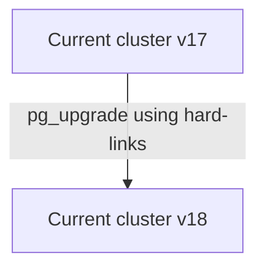
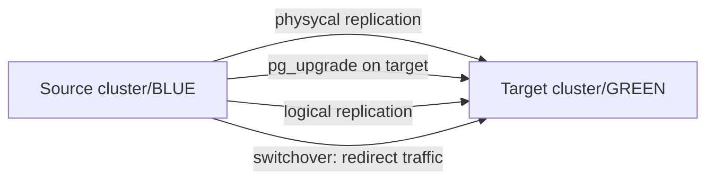

## PostgreSQL major upgrade

This role is designed for in-place or blue-green upgrade methods (e.g., from version 17 to 18).

Both single-node and multi-node Patroni clusters are supported.

**Playbooks**

In-place method:
- `pg_upgrade` - Upgrades the PostgreSQL to a new major version.
- `pg_upgrade_rollback` - Performs a rollback of a PostgreSQL upgrade.

Blue-green method:
- `pg_logical_upgrade` - Upgrades the target cluster and converting a physical replica into a logical replica.
- `pg_logical_switchover` - Redirects PostgreSQL traffic from the source cluster to the target cluster with near-zero downtime.
- `pg_logical_switchover_rollback` - Switches PostgreSQL traffic back to the source cluster.
- `pg_logical_replication_stop` - Clean up publications, subscriptions, and replication slots.

#### How it works

`In-place` method upgrades the current production cluster directly. It is simpler and does not require additional servers, but it usually requires a short maintenance window (typically about 1 minute, depending on workload and environment).

Schematic:



`Blue-green` method upgrades a separate target cluster that is a copy of the current one, so upgrade stages on target do not impact production availability. This method is suitable when downtime must be limited to a few seconds: during switchover, the source cluster is briefly set to read-only, traffic is redirected to target (by updating PgBouncer pool backend IPs), and you can observe stability before switching the application to the address of the new cluster or rolling back to the source cluster if needed. 

Schematic:



Rollback is possible without losing changes made after cutover, because reverse logical replication (source <- target) is created during traffic switching.

**Database Downtime Considerations**

`In-place` To minimize the downtime, we pause PgBouncer pools (or enable the maintenance mode of [PgDog](../pgdog/README.md), which works the same way for the clients). This doesn’t terminate application connections, but may temporarily increase query latency while pools are paused. The pause typically lasts ~30-60 seconds, but may be longer for large databases due to pg_upgrade and rsync. The default maximum wait time during a pause is 2 minutes (controlled by the query_wait_timeout parameter).

`Blue-green` A short service impact occurs only during switchover: the source cluster is briefly set to read-only, the remaining logical replication lag is drained, and traffic is redirected to target. Only the write traffic degrades (~10-15 seconds), while the read traffic has near-zero downtime.

## Compatibility

The upgrade is supported starting from PostgreSQL 9.3 for in-place upgrade method, and starting from PostgreSQL 12 for blue-green upgrade method.

## Requirements

Specify the current (old) version of PostgreSQL in the `pg_old_version` variable and target version of PostgreSQL for the upgrade in the `pg_new_version` variable.

For the blue-green method, deploy the target cluster in standby cluster mode. See `patroni_standby_cluster` variable.

## Recommendations

1. Before upgrading to a new major version, it's recommended to update PostgreSQL and its extensions. Additionally, consider updating Patroni and the entire system.

   To achieve this, use the `update_pgcluster.yml` playbook. More details can be found [here](../update/README.md).

2. Before moving forward, execute preliminary checks to ensure that your database schema is compatible with the upcoming PostgreSQL version and that the cluster is ready for the upgrade.

   To do this, run the playbook using the tags '`pre-checks,upgrade-check`'.

   If any errors arise, such as schema object incompatibilities, resolve these issues and repeat the checks.

   Once the playbook completes the pre-checks without any errors, you should see the following messages in the Ansible log:
   - "`The database schema is compatible with PostgreSQL <new_version>`"
   - "`Clusters are compatible`"

   Upon seeing these messages, proceed to run the playbook without any tags to initiate the upgrade.

## Upgrade

### In-place upgrade method

Use `pg_upgrade` playbook, example:

```bash
ansible-playbook pg_upgrade.yml -i inventory -e "pg_old_version=17 pg_new_version=18"
```

**Rollback**

It's designed to be used when a PostgreSQL upgrade hasn't been fully completed and the new version hasn't been started.

```bash
ansible-playbook pg_upgrade_rollback.yml -i inventory
```

In some scenarios, if errors occur, the pg_upgrade.yml playbook may automatically initiate a rollback. Alternatively, if the automatic rollback does not occur, you can manually execute the pg_upgrade_rollback playbook to revert the changes.

The rollback operation is performed by starting the Patroni cluster with the old version of PostgreSQL using the same PGDATA. The playbook first checks the health of the current cluster, verifies the version of PostgreSQL, and ensures the new PostgreSQL is not running. If these checks pass, the playbook switches back to the old PostgreSQL paths and restarts the Patroni service.

### Blue-green upgrade method

Use `pg_logical_upgrade` playbook, example:

##### 1. Deploy the target (standby cluster)

TIP: During target cluster deployment, it is enough to point the standby cluster to the source cluster by setting either `source_cluster_host` to an IP address of the source cluster host.

Create `inventory.yml` file: describe the nodes of the current and target cluster.

```yaml
---
all:
  vars:
    # upgrade settings
    pg_old_version: 17 # the current (old) version of PostgreSQL
    pg_new_version: 18 # the target (new) version of PostgreSQL for the upgrade
    pg_replication_database: "all" # dbname for replication, 'all' for the entire cluster
    pg_publication_count: 1 # number of publications, replication slots and subscriptions
    # connection settings
    ansible_ssh_user: root
    ansible_ssh_private_key_file: /home/ubuntu/.ssh/id_rsa
  children:
    source_cluster:
      hosts:
        10.142.0.21:
        10.142.0.22:
        10.142.0.23:
    target_cluster:
      hosts:
        10.142.0.24:
        10.142.0.26:
        10.142.0.43:
```

##### 2. Upgrade the target cluster:

```bash
ansible-playbook pg_logical_upgrade.yml -i inventory.yml
```

##### 3. Switchover to the target cluster:

After pg_logical_upgrade is completed and logical replication is active (source -> target), use `pg_logical_switchover` playbook to switch production traffic to the target cluster.

```bash
ansible-playbook playbooks/pg_logical_switchover.yml -i inventory.yml
```

WARNING: If PgBouncer is not installed in your cluster, for example if you use PgDog, traffic redirection will not happen automatically.
In this case, use the following sequence:
   1. Stop your application
   2. Run the pg_logical_switchover playbook
   3. Start your application and point it to the new (target) cluster address

Optionally:

- **Force mode** (allow a small lag during cutover):

    ```bash
    ansible-playbook playbooks/pg_logical_switchover.yml -i inventory.yml \
      -e "pg_switchover_force_mode=true pg_switchover_force_mode_lag_bytes=1048576"
    ```

- **Rollback** after switchover (if you need to move traffic back to the original cluster):

    ```bash
    ansible-playbook playbooks/pg_logical_switchover_rollback.yml -i inventory.yml
    ```

##### 4. Switch application to the target cluster

After observing your services and database on the new cluster, if everything is stable, switch your application to the new cluster by updating the connection string with the new cluster address.

##### 5. Stop reverse replication

To clean up logical replication objects after migration (subscriptions, replication slots, and publications), run:

```bash
ansible-playbook playbooks/pg_logical_replication_stop.yml -i inventory.yml
```

---


## Variables

Upgrade settings (for both methods):

| Variable Name                                | Description                                                                                                                                                                           | Default Value |
| -------------------------------------------- | ------------------------------------------------------------------------------------------------------------------------------------------------------------------------------------- | ------------: |
| `pg_old_version`                             | Current (old) version of PostgreSQL.                                                                                                                                                  |          `""` |
| `pg_new_version`                             | Target version of PostgreSQL for the upgrade.                                                                                                                                         |          `""` |
| `pg_old_bindir`                              | Directory containing binaries for the old PostgreSQL version.                                                                                                                         | Derived value |
| `pg_old_datadir`                             | Data directory path for the old PostgreSQL version.                                                                                                                                   | Derived value |
| `pg_old_confdir`                             | Configuration directory path for the old PostgreSQL version.                                                                                                                          | Derived value |
| `pg_new_bindir`                              | Directory containing binaries for the new PostgreSQL version.                                                                                                                         | Derived value |
| `pg_new_datadir`                             | Data directory path for the new PostgreSQL version.                                                                                                                                   | Derived value |
| `pg_new_confdir`                             | Configuration directory path for the new PostgreSQL version.                                                                                                                          | Derived value |
| `pg_new_wal_dir`                             | Custom WAL directory for the new PostgreSQL version.                                                                                                                                  | Derived value |
| `pg_upper_datadir`                           | Top-level directory containing both old and new PostgreSQL data directories.                                                                                                          | Derived value |
| `pg_new_packages`                            | List of package names for the new PostgreSQL version to be installed.                                                                                                                 | Derived value |
| `pg_old_packages_remove`                     | Whether to remove old PostgreSQL packages after the upgrade.                                                                                                                          |        `true` |
| `pg_start_stop_timeout`                      | Timeout when starting/stopping PostgreSQL during the upgrade (in seconds).                                                                                                            |        `1800` |
| `schema_compatibility_check`                 | Check database schema compatibility with the new PostgreSQL version before upgrading.                                                                                                 |        `true` |
| `schema_compatibility_check_port`            | Port for temporary PostgreSQL instance for schema compatibility checking.                                                                                                             | Derived value |
| `schema_compatibility_check_timeout`         | Max duration for compatibility check (pg_dumpall --schema-only) in seconds.                                                                                                           |        `3600` |
| `vacuumdb_parallel_jobs`                     | Execute the analyze command in parallel by running `njobs` commands simultaneously. This option may reduce the processing time but it also increases the load on the database server. | all CPU cores |
| `vacuumdb_analyze_timeout`                   | Max duration of analyze command in seconds.                                                                                                                                           |        `3600` |
| `vacuumdb_analyze_terminate_treshold`        | Terminate active queries that are longer than the specified time (in seconds) during the collection of statistics (0 = do not terminate active backends).                             |           `0` |
| `update_extensions`                          | Automatically update all PostgreSQL extensions.                                                                                                                                       |        `true` |
| `max_replication_lag_bytes`                  | Maximum allowed replication lag in bytes.                                                                                                                                             |    `10485760` |
| `max_transaction_sec`                        | Maximum allowed duration for a transaction in seconds.                                                                                                                                |          `15` |
| `copy_files_to_all_server`                   | Copy files located in the "files" directory to all servers. (optional)                                                                                                                |          `[]` |
| `pgbouncer_pool_pause`                       | Pause pgbouncer pools during upgrade.                                                                                                                                                 |        `true` |
| `pgbouncer_pool_pause_timeout`               | The maximum waiting time (in seconds) for the pool to be paused. For each iteration of the loop when trying to pause all pools.                                                       |           `2` |
| `pgbouncer_pool_pause_terminate_after`       | Time in seconds after which script terminates slow active queries.                                                                                                                    |          `30` |
| `pgbouncer_pool_pause_stop_after`            | Time in seconds after which the script exits with an error if unable to pause all pgbouncer pools.                                                                                    |          `60` |
| `pgdog_pool_pause`                           | Hold the client queries in PgDog during upgrade. It uses the `pgbouncer_pool_pause_terminate_after` and `pgbouncer_pool_pause_stop_after` times. | `true` |
| `pg_slow_active_query_treshold`              | Time in milliseconds to wait for active queries before trying to pause the pool.                                                                                                      |        `1000` |
| `pg_slow_active_query_treshold_to_terminate` | Time in milliseconds after reaching "pgbouncer_pool_pause_terminate_after" before the script terminates active queries.                                                               |         `100` |
| `pgbackrest_stanza_upgrade`                  | Perform the "stanza-upgrade" command after the upgrade (if 'pgbackrest_install' is 'true').                                                                                           |        `true` |
| `pg_install_user_password`                  | The Postgres install user (rolname with oid = 10) password. | `{{ patroni_superuser_password }}` |

Blue-green deployment method settings:

| Variable Name                                | Description                                                                                                           | Default Value |
| -------------------------------------------- | --------------------------------------------------------------------------------------------------------------------- | ------------: |
| `pg_replication_database`                    | Database name for the replication, 'all' for the entire database cluster.                                             |  `all`        |
| `pg_allow_replica_identity_full`             | Set REPLICA IDENTITY FULL on tables without primary key.                                                              |  `true`       |
| `pg_publication_count`                       | Number of publications, replication slots and subscriptions to be created for logical replication (source -> target). |  `1`          |
| `pg_publication_name`                        | Publication name for logical replication.                                                                    | `pg_upgrade_publication` |
| `pg_subscription_name`                       | Subscription name for the logical replication.                                                                        | `pg_upgrade_subscription` |
| `pg_subscription_slot_name`                  | Subscription slot name for the logical replication. Base prefix for logical replication slot names; each slot name includes the database name (and _01, _02, ... suffix if pg_publication_count > 1) | `{{ pg_subscription_name }}_slot` |
| `pg_wal_keep_gigabytes`                       | The number of WAL files (in gigabytes) to hold in the source cluster. Set '`none`' to not change the wal_keep_segments/wal_keep_size parameter. | `100` |
| `pg_switchover_max_replication_lag_bytes`    | Maximum allowed logical replication lag (in bytes) before switchover.                                                | `16777216` |
| `pg_switchover_no_lag_wait_timeout`          | Timeout in seconds for "Plan A": wait until logical replication lag is 0 bytes before switchover.                    | `10` |
| `pg_switchover_force_mode`                   | Enable "Plan B": allow switchover with a small replication lag.                                                      | `false` |
| `pg_switchover_force_mode_lag_bytes`         | Allowed logical replication lag (in bytes) for force mode (`pg_switchover_force_mode=true`).                         | `1048576` |
| `pg_reverse_logical_replication`             | Enable reverse logical replication (source <- target) to support rollback without losing changes.                    | `true` |
| `pg_reverse_publication_name`                | Publication name for reverse logical replication.                                                                    | `reverse_{{ pg_publication_name }}` |
| `pg_reverse_subscription_name`               | Subscription name for reverse logical replication.                                                                   | `reverse_{{ pg_subscription_name }}` |
| `pg_reverse_subscription_slot_name`          | Subscription slot name for reverse logical replication.                                                              | `reverse_{{ pg_subscription_slot_name }}` |
| `pg_sequences_increase_value`                | Value added (+N) to sequence values in the new cluster before switchover.                                            | `1000000` |

Note: For more information, see the `upgrade` role [variables](../upgrade/defaults/main.yml) file.

---

### Upgrade Plan:

#### PRE-UPGRADE: Perform Pre-Checks

- **Make sure that the required variables are specified**
  - Notes: `pg_old_version` and `pg_new_version` variables
  - Stop, if one or more required variables have empty values.
- **Make sure that the old and new data and config directories do not match**
  - Stop, if `pg_old_datadir` and `pg_new_datadir`, or `pg_old_confdir` and `pg_new_confdir` match.
- **Make sure the ansible required Python library is installed**
  - Notes: Install 'pexpect' package if missing
- **Test PostgreSQL database access using a unix socket**
  - if there is an error (no pg_hba.conf entry):
    - Add temporary local hba rule (during the upgrade)
    - Update the PostgreSQL configuration
- **Check the current version of PostgreSQL**
  - Stop, if the current version does not match `pg_old_version`
  - Stop, if the current version greater than or equal to `pg_new_version`. No upgrade is needed.
- **Ensure new data directory is different from the current one**
  - Note: This check is necessary to avoid the risk of deleting the current data directory
  - Stop, if the current data directory is the same as `pg_new_datadir`.
  - Stop, if the current WAL directory is the same as `pg_new_wal_dir` (if a custom wal dir is used).
- **Perform pre-checks and preparation for blue-green upgrade method**
  - *Note: If the `pg_logical_upgrade.yml` playbook is used*
  - Get a list of databases from the source cluster
    - Note: if `pg_replication_database` == "`all`" (default: all)
  - Make sure that the wal_level parameter is set to 'logical'
    - Stop, if wal_level != logical
  - Make sure that the max_logical_replication_workers parameter is sufficient
    - Stop, if max_logical_replication_workers is too low for the number of publications and databases
  - Test access from the target cluster to the source database
  - Test access from the source cluster to the target database
  - Make sure there are no tables with replica identity "nothing"
  - Make sure that tables with replica identity "default" have primary key
  - Set REPLICA IDENTITY FULL for tables without primary key
    - Note: if `pg_allow_replica_identity_full` is `true` (default: true)
  - Make sure that the 'restore_command' parameter is not specified
    - if 'restore_command' is specified: comment out recovery_conf in patroni.yml
  - Increase the wal_keep_segments/wal_keep_size parameter on the source primary
    - if `pg_wal_keep_gigabytes` != `none` (default: 100)
    - Note: To guarantee that the necessary WAL files are available to reach recovery_target_lsn via streaming replication.
- **Make sure that physical replication is active**
  - Stop, if there are no active replicas
- **Make sure there is no high replication lag**
  - Stop, if replication lag is high (more than `max_replication_lag_bytes`)
- **Make sure there are no long-running transactions**
  - Stop, if long-running transactions detected (more than `max_transaction_sec`)
- **Make sure that SSH key-based authentication is configured between cluster nodes**
  - Create and copy ssh keys between database servers (if not configured)
- **Perform Rsync Checks**
  - Make sure that the rsync package are installed
  - Create 'testrsync' file on primary
  - Test rsync and ssh key access
  - Cleanup 'testrsync' file
- **Check if PostgreSQL tablespaces exist**
  - Print tablespace location (if exists)
  - Note: If tablespaces are present they will be upgraded (step 5) on replicas using rsync
- **Make sure that the 'recovery.signal' file is absent** in the data directory
- **Test PgBouncer access via unix socket**
  - Ensure correct permissions for PgBouncer unix socket directory
  - Test access via unix socket to be able to perform 'PAUSE' command
- **Test PgDog access to the admin database**
  - Notes: if 'pgdog_install' is 'true' and 'pgdog_pool_pause' is 'true'

#### PRE-UPGRADE: Install new PostgreSQL packages

- Clean yum/dnf cache (for RedHat based) or Update apt cache for (Debian based)
- Install new PostgreSQL packages
- Install TimescaleDB package for new PostgreSQL
  - Note: if 'enable_timescale' is 'true'

#### PRE-UPGRADE: Initialize new db, schema compatibility check, and pg_upgrade --check

- **Initialize new PostgreSQL**
  - Make sure new PostgreSQL data directory exists
  - Make sure new PostgreSQL data directory is not initialized
    - If already initialized:
      - Perform pg_dropcluster (for Debian based)
      - Clear the new PostgreSQL data directory
  - Get the current install user (rolname with oid = 10)
  - Get the current encoding, locale, and data_checksums settings
  - Initialize new PostgreSQL data directory
    - Preserve the source locale and checksums settings
- **Copy files specified in the `upgrade_copy_files_to_all_server` variable** [optional]
  - Notes: for example, it may be necessary for Postgres Full-Text Search (FTS) files
- **Schema compatibility check**
  - Get the current `shared_preload_libraries` settings
  - Get the current `cron.database_name` settings
    - Notes: if 'pg_cron' is defined in 'pg_shared_preload_libraries'
  - Start new PostgreSQL to check the schema compatibility
    - Note: on the port specified in the `schema_compatibility_check_port` variable
    - Wait for PostgreSQL to start
  - Check the compatibility of the database schema with the new PostgreSQL
    - Notes: used `pg_dumpall` with `--schema-only` options
    - Wait for the schema compatibility check to complete
  - Checking the result of the schema compatibility
    - Note: Checking for errors in `/tmp/pg_schema_compatibility_check.log`
    - Stop, if the schema is not compatible (there are errors)
  - Print result of checking the compatibility of the schema
  - Stop new PostgreSQL to re-initdb
  - Drop new PostgreSQL to re-initdb (perform pg_dropcluster for Debian based)
  - Reinitialize the database after checking schema compatibility
- **Perform pg_upgrade check**
  - Get the current `shared_preload_libraries` settings
  - Verify the two clusters are compatible (`pg_upgrade --check`)
  - Print the result of the pg_upgrade check

#### PRE-UPGRADE: Create a publication/slot and reach recovery_target_lsn
  - *Note: for blue-green upgrade method (`pg_logical_upgrade.yml` playbook)*
  - Stop PostgreSQL on target primary
    - Pause WAL replay (recovery) on the target cluster replicas
    - Pause Patroni on the target cluster before stopping PostgreSQL
    - Execute CHECKPOINT before stopping PostgreSQL
    - Wait for the CHECKPOINT to complete
    - Stop Patroni service on the standby cluster leader before stopping PostgreSQL
    - Wait for Patroni REST API to stop on the standby cluster leader
    - Stop PostgreSQL on the standby cluster leader
  - Create a publication and logical replication slot for each database
    - Get a list of tables distributed by groups
      - Note: Split tables (sorted by DML activity) into groups for publications to evenly distribute tables across slots.
      - if `pg_publication_count` more than 1 (default: 1)
    - Start pg_terminator script
      - Note: Monitor locks and terminate the 'create publication' blockers
    - Create publications for logical replication
    - Create slots for logical replication
    - Stop pg_terminator script
    - Set variable: target_lsn
    - Advance replication slots to target_lsn for each database
  - Reach recovery_target_lsn on target primary
    - Specify recovery parameters on the standby cluster leader
    - Start PostgreSQL on standby cluster leader to reach recovery_target_lsn
    - Wait for the PostgreSQL start to complete
    - Wait until the recovery is complete
    - Check the PostgreSQL log file
    - Resume WAL replay (recovery) on target cluster replicas
    - Wait until physical replication becomes active
    - Wait until physical replication lag is 0 bytes

#### PRE-UPGRADE: Prepare the Patroni configuration

- Backup the patroni.yml configuration file
- Edit the patroni.yml configuration file
  - **Update parameters**: `data_dir`, `bin_dir`, `config_dir`
  - **Prepare the PostgreSQL parameters**
    - Notes: Removed or renamed parameters
  - **Remove 'standby_cluster' parameter (if exists)**
    - Notes: To support upgrades in the Patroni standby cluster
- **Copy pg_hba.conf to `pg_new_confdir`**
  - Notes: to save pg_hba rules

#### UPGRADE: Upgrade PostgreSQL

- **Enable maintenance mode for Patroni cluster** (pause)
- **Enable maintenance mode for HAProxy** (if used)
  - Notes: if 'pgbouncer_install' is 'true' and 'pgbouncer_pool_pause' is 'true'
  - Stop confd service
  - Update haproxy conf file
    - Notes: Temporarily disable http-checks in order to keep database connections after stopping the Patroni service
  - Reload haproxy service
- **Enable maintenance mode for vip-manager** (if used)
  - Notes: if 'pgbouncer_install' is 'true' and 'pgbouncer_pool_pause' is 'true'
  - Update vip-manager service file (comment out 'ExecStopPost')
    - Notes: Temporarily disable vip-manager service to keep database connections after stopping the Patroni service
  - Stop vip-manager service
    - Notes: This prevents the VIP from being removed when the Patroni leader is unavailable during maintenance
  - Make sure that the cluster ip address (VIP) is running
- **Stop Patroni service**
  - Wait until the Patroni cluster is stopped
- **Execute CHECKPOINT before stopping PostgreSQL**
  - Wait for the CHECKPOINT to complete
- **Wait until replication lag is less than `max_replication_lag_bytes`**
  - Notes: max wait time: 2 minutes
  - Stop, if replication lag is high
  - Perform rollback
    - Print error message: "There's a replication lag in the PostgreSQL cluster. Please try again later"
- **Enable maintenance mode on all PgDog servers**
  - Notes: if 'pgdog_install' is 'true' and 'pgdog_pool_pause' is 'true'
  - Notes: sends `MAINTENANCE ON` to every PgDog server, which holds new queries, and then waits for the active queries to complete. It terminates them after `pgbouncer_pool_pause_terminate_after` seconds, and performs a rollback after `pgbouncer_pool_pause_stop_after` seconds
- **Perform PAUSE on all pgbouncers servers**
  - Notes: if 'pgbouncer_install' is 'true' and 'pgbouncer_pool_pause' is 'true'
  - Notes: pgbouncer pause script performs the following actions:
    - Waits for active queries on the database servers to complete (with a runtime more than `pg_slow_active_query_treshold`).
    - If there are no active queries, sends a `PAUSE` command to each PgBouncer server in parallel (using `xargs` and ssh connections).
    - If all PgBouncer pools are successfully paused, the script exits with code 0 (successful).
    - If active queries do not complete within 30 seconds (`pgbouncer_pool_pause_terminate_after` variable), the script terminates slow active queries (longer than `pg_slow_active_query_treshold_to_terminate`).
    - If after that it is still not possible to pause the pgbouncer servers within 60 seconds (`pgbouncer_pool_pause_stop_after` variable) from the start of the script, the script exits with an error.
      - Perform rollback
        - Print error message: "PgBouncer pools could not be paused, please try again later."
- **Stop PostgreSQL** on the leader and replicas
  - Check if old PostgreSQL is stopped
  - Check if new PostgreSQL is stopped
- **Get 'Latest checkpoint location'** on the leader and replicas
  - Print 'Latest checkpoint location' for the leader and replicas
- **Check if all 'Latest checkpoint location' values match**
  - if 'Latest checkpoint location' values match
    - Print info message:
      - "'Latest checkpoint location' is the same on the leader and its standbys"
  - if 'Latest checkpoint location' values do not match
    - Perform rollback
      - Print error message: "Latest checkpoint location' doesn't match on leader and its standbys. Please try again later"
- **Upgrade the PostgreSQL on the primary** (using pg_upgrade --link)
  - Perform rollback, if the upgrade failed
  - Print the result of the pg_upgrade
- **Make sure that the new data directory is empty on the replica**
- **Upgrade the PostgreSQL on the replica** (using rsync --hard-links)
  - Wait for the rsync to complete
- **Upgrade the PostgreSQL tablespaces on the replica** (using rsync --hard-links)
  - Notes: if tablespaces exist
  - Wait for the tablespaces rsync to complete
- **Synchronize WAL directory** (if `pg_new_wal_dir` is defined) [optional]
  - Make sure new pg_wal directory is not symlink
  - Make sure the custom WAL directory exists and is empty
  - Synchronize new pg_wal to 'pg_new_wal_dir' path
  - Rename pg_wal to pg_wal_old
  - Create symlink
  - Remove 'pg_wal_old' directory
- **Remove existing cluster from DCS**
- **Start Patroni service on the cluster leader**
  - Wait for Patroni port to become open on the host
  - Check Patroni is healthy on the leader
- **Perform RESUME PgBouncer pools on the leader**
  - Notes: if 'pgbouncer_install' is 'true' and 'pgbouncer_pool_pause' is 'true'
- **Start Patroni service on the cluster replica**
  - Wait for Patroni port to become open on the host
  - Check Patroni is healthy on the replica
- **Perform RESUME PgBouncer pools on the replica**
  - Notes: if 'pgbouncer_install' is 'true' and 'pgbouncer_pool_pause' is 'true'
- **Check PostgreSQL is started and accepting connections**
- **Disable maintenance mode for HAProxy** (if used)
  - Update haproxy conf file
    - Notes: Enable http-checks
  - Reload haproxy service
  - Start confd service
- **Disable maintenance mode for vip-manager** (if used)
  - Update vip-manager service file (uncomment 'ExecStopPost')
  - Start vip-manager service
  - Make sure that the cluster ip address (VIP) is running

#### POST-UPGRADE: Create a subscription for logical replication
  - *Note: for blue-green upgrade method (`pg_logical_upgrade.yml` playbook)*
  - Create a subscription on target primary
    - Create subscription for logical replication in each database
    - Make sure that logical replication is active
    - Check the logical replication lag

#### POST-UPGRADE: Analyze a PostgreSQL database (update optimizer statistics) and Post-Upgrade tasks

- **Run vacuumdb to analyze the PostgreSQL databases**
  - Note: Uses parallel processes equal to 50% of CPU cores ('`vacuumdb_parallel_jobs`' variable)
  - Note: Before collecting statistics, the 'pg_terminator' script is launched to monitor and terminate any 'ANALYZE' blockers. Once statistics collection is complete, the script is stopped.
- **Update extensions in each database**
  - Get list of installed PostgreSQL extensions
  - Get list of old PostgreSQL extensions
    - Update old PostgreSQL extensions
      - Notes: excluding: 'pg_repack' and 'pg_stat_kcache' (if exists), as they require re-creation to update
    - Recreate old pg_stat_statements and pg_stat_kcache extensions to update
      - Notes: if pg_stat_kcache is installed
    - Recreate old pg_repack extension to update
      - Notes: if pg_repack is installed
    - Notes: if there are no old extensions, print message:
      - "The extension versions are up-to-date for the database. No update is required."
- **Perform Post-Checks**
  - Make sure that physical replication is active
    - Note: if no active replication connections found, print error message: "No active replication connections found. Please check the replication status and PostgreSQL logs."
    - Create a table "test_replication" with 10000 rows on the primary
    - Wait until the PostgreSQL replica is synchronized (max wait time: 2 minutes)
    - Drop a table "test_replication"
    - Print the result of checking the number of records
    - if the number of rows match, print info message: "The PostgreSQL replication is OK. The number of records in the 'test_replication' table is the same as on the primary."
    - if the number of rows does not match, print error message: "The number of records in the 'test_replication' table does not match the primary. Please check the replication status and PostgreSQL logs."
- **Perform Post-Upgrade tasks**
  - **Perform tasks for blue-green upgrade method**
    - *Note: If the `pg_logical_upgrade.yml` playbook is used*
    - Reset the wal_keep_segments/wal_keep_size parameter to original state on the source primary
  - **Ensure the current data directory is the new data directory**
    - Notes: to prevent deletion the old directory if it is used
  - **Delete the old PostgreSQL data directory**
    - Notes: perform pg_dropcluster for Debian based
  - **Delete the old PostgreSQL WAL directory**
    - Notes: if 'pg_new_wal_dir' is defined
  - **Remove old PostgreSQL packages**
    - Notes: if 'pg_old_packages_remove' is 'true'
  - **Remove temporary local hba rule from pg_hba.conf**
    - Notes: if it has been changed
    - Update the PostgreSQL configuration
  - **pgBackRest** (if 'pgbackrest_install' is 'true')
    - Check pg-path option
    - Update pg-path in pgbackrest.conf
    - Upgrade stanza
  - **WAL-G** (if 'wal_g_install' is 'true')
    - Update PostgreSQL data directory path in .walg.json
    - Update PostgreSQL data directory path in cron jobs
  - **Wait for the analyze to complete.**
    - Notes: max wait time: 1 hour ('`vacuumdb_analyze_timeout`' variable)
  - **Check the Patroni cluster state**
  - **Check the current PostgreSQL version**
  - **Print info messages**
    - List the Patroni cluster members
    - Upgrade completed

## Switchover plan

Note: for blue-green upgrade method (`pg_logical_switchover` playbook)

- **Perform pre-checks**
  - Ensure logical replication lag is no more than `max_replication_lag_bytes` (default: 10485760)
  - Print logical replication lag
- **Prepare pgbouncer configuration**
  - Note: if `pgbouncer_install` is `true`
  - Prepare PgBouncer configuration to redirect primary traffic
    - Note: replace the 'host=' option value with the target primary host address
  - Prepare PgBouncer configuration to redirect replica traffic
    - Note: replace the 'host=' option value with target hosts addresses using deterministic mapping by replica index; if target has no replicas, use target primary
  - Temporarily disable TLS from PgBouncer to Postgres during redirect
    - Note: if self-signed certificates are used (tls_cert_generate = true), target cluster uses a different CA, so PgBouncer on source may fail to verify TLS when connecting to Postgres on target
- **Increase all sequence values**
  - Get sequence values for each database
  - Increase sequence values for each database
  - Note: Add + `pg_sequences_increase_value` to current value (default: 1000000)
- **Wait for a window with low replication lag**
  - Ensure logical replication lag is no more than `pg_switchover_max_replication_lag_bytes` (default: 16777216)
- **Enable read-only mode on the source cluster**
  - Set `default_transaction_read_only = 'on'`
  - Reload PostgreSQL configuration
- **Wait until there is no replication lag**
  - Wait until the lag is 0 bytes
  - or no more than `pg_switchover_force_mode_lag_bytes` (default: 1048576) if force mode is enabled (`pg_switchover_force_mode`)
- **Delete the previous subscription**
  - Drop subscription in each database
- **Create publication and slot for reverse replication**
  - Create publication and slot for each database
- **Redirect database traffic to the target cluster**
  - Note: if `pgbouncer_install` is `true`
  - Restart pgbouncer service to apply changes
- **Disable read-only mode on the source cluster**
  - Reset `default_transaction_read_only` option
  - Reload PostgreSQL configuration
- **Start reverse logical replication**
  - Create subscription in each database
  - Make sure that logical replication is active
  - Check the logical replication lag
- **Print info messages**
  - Switchover completed
  - Final step: switch application services to the target cluster

## Dependencies

This role depends on:
- `vitabaks.autobase.common` - Provides common variables and configurations
